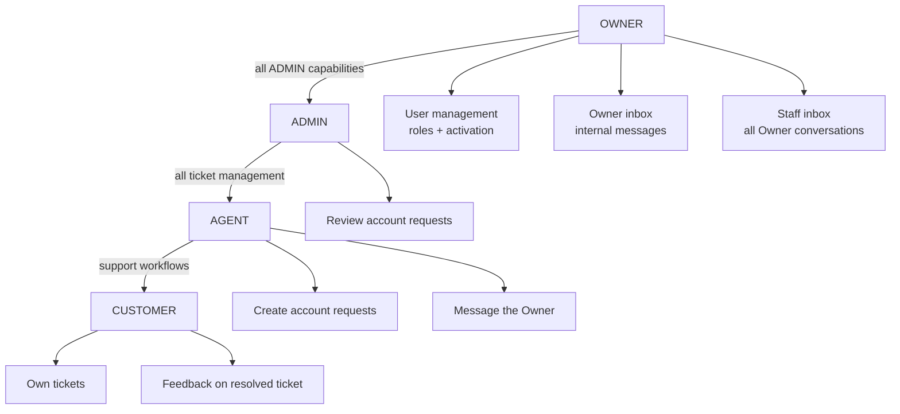
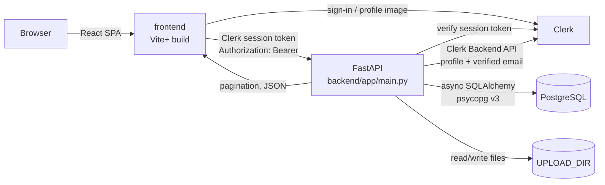
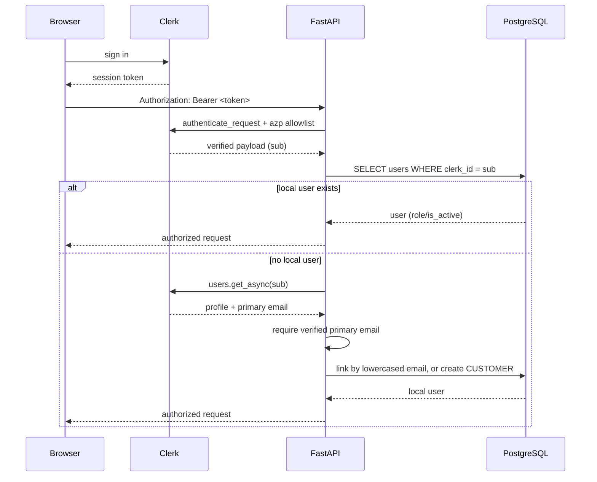
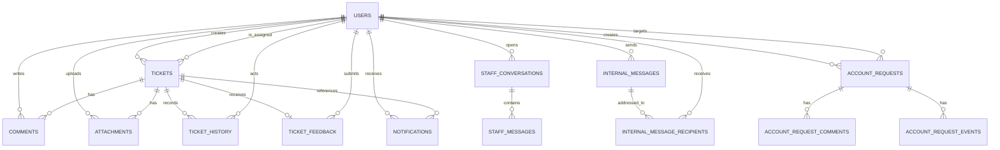
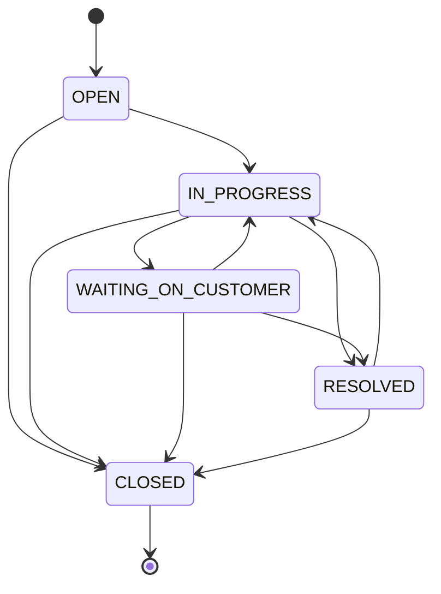
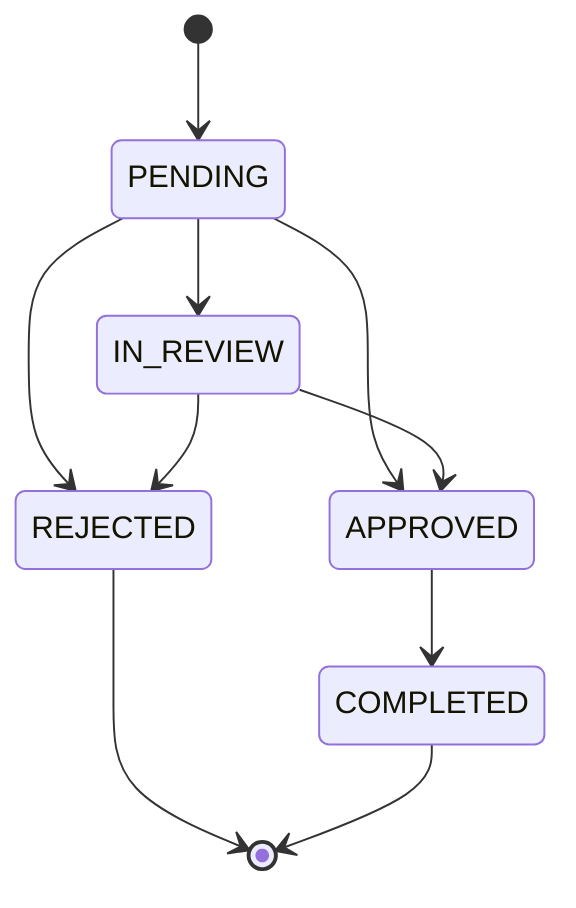

# HelpDesk — Project Context

> Canonical, source-verified project context for the HelpDesk SaaS application.
>
> Generated: 2026-10-23; remediation update: 2026-10-24; hardening update:
> 2026-10-25; production-hardening update: **2026-10-29**
> Repository: `/home/jayed/Projects/HelpDesk`
> Branch inspected: `oddit` (HEAD `e85345b`, same commit as `main`)
> Working tree: **dirty** — 31 modified tracked files and 17 untracked paths,
> including inherited Ruff changes and this uncommitted production-hardening
> work (see §2). Current evidence, statuses, and the Railway runbook are in
> `data.md` and `docs/DEPLOYMENT.md`; §22–§25 retain their pre-hardening history
> where they have not been explicitly amended.

## Claim labels

Every non-trivial statement in this document is labelled where useful:

| Label | Meaning |
| --- | --- |
| **Verified** | Read directly from the local source, or observed by running a read-only command in this repository. |
| **Historically reported** | Present only in prior conversation/report context, not re-proven from source. |
| **Inferred** | A reasoned conclusion from the source, not an explicit statement or test. |
| **Unverified** | Could not be confirmed with the available local evidence. |

No secret values, tokens, passwords, or database URLs are reproduced in this document.

---

## 1. Purpose, status, and how to use this document

This file is the single place to recover the architecture, business rules, and
operational knowledge of the HelpDesk project without re-reading the whole
codebase. It is written to be:

- **source of truth for onboarding** — it names real paths, classes, routes and
  tables;
- **explicit about uncertainty** — every claim is labelled;
- **safe to update** — it describes the repository, not a specific deployment.

The companion file `data.md` contains the full audit report and remediation
record (scope, evidence, completed changes, findings, test results, and residual
risk).

Sections §2–§9 describe *what exists*; §10–§23 describe *how it behaves*; §24
records what was actually executed; §25 lists finding status and next actions.

---

## 2. Project identity and repository state

| Item | Value | Evidence |
| --- | --- | --- |
| Product | HelpDesk — multi-role support-ticket SaaS | **Verified** |
| Backend | FastAPI + SQLModel/SQLAlchemy async + PostgreSQL | **Verified** |
| Frontend | React 19 SPA (Vite+) + Chakra UI + Clerk | **Verified** |
| Default branch state | branch `oddit`, HEAD `e85345b`; same commit as `main` | **Verified** (`git log`, `git branch -vv`) |
| Tracked files | 219 | **Verified** (`git ls-files`) |
| Commits | 29 | **Verified** (`git rev-list --count HEAD`) |
| Working tree | 31 modified tracked files **plus** 17 untracked paths; intentionally not clean and not committed | **Verified** (`git status --porcelain`) |
| Untracked files | `backend/Dockerfile`, `.dockerignore`, entrypoint, health/logging/middleware modules, production-hardening tests; frontend Dockerfile, Nginx template, entrypoint, `.env.example`, `.nvmrc`, `theme-init.js`, `apiBase.ts`/test; `docs/DEPLOYMENT.md` | **Verified** (`git status --porcelain`) |
| Root files | `backend/`, `frontend/`, `data.md`, `PROJECT_CONTEXT.md`, `.github/`, `.gitignore`, `.idea/`, `.junie/`, `package-lock.json` | **Verified** |

### Nature of the pre-existing uncommitted changes

The dirty tree inherited at the start of remediation was **formatting/import
modernisation**, not feature work:

- `datetime.timezone.utc` → `datetime.UTC` and `from datetime import UTC, datetime`;
- `typing.Sequence`/`Union` → `collections.abc.Sequence` and `X | None`;
- import sorting and line wrapping in migrations and tests.

Spot-checked diffs: `backend/app/models/user.py`,
`backend/migrations/versions/0001_initial_schema.py`, `backend/tests/conftest.py`.
**Verified** for those files; **Inferred** for the remaining modified files,
based on the equal add/remove counts and the affected rule families.

> Operational note: the pre-existing changes were preserved. No reset,
> restore, checkout, stash, rebase, commit, or branch switch was performed.
> The tree also contains the remediation described in `data.md`; do not attribute
> the entire diff to one author or one change set.

---

## 3. Product scope and user roles

HelpDesk is a multi-tenant-style support desk with four application roles.

| Role | Scope | Can do | Cannot do |
| --- | --- | --- | --- |
| `customer` | Own tickets | Create tickets, read/update own open tickets, comment publicly, upload/download attachments on visible tickets, submit feedback on a resolved ticket, manage own profile/avatar | See other customers' tickets, internal notes, ticket history, staff messaging, account requests, user administration |
| `agent` | Assigned tickets + unassigned queue | View/claim unassigned tickets, update assigned tickets (status/priority/category/text), comment including internal notes, upload attachments, open account requests, message the Owner | Assign tickets to others, administer users, decide account requests |
| `admin` | All tickets | Everything an agent can do on any ticket, assign/unassign tickets, view admin dashboard and user directory, review/decide account requests, message the Owner | Change roles/status of users (Owner-only), become an assignee, claim from the agent-only queue |
| `owner` | Whole application | All admin capabilities plus exclusive user management, Owner inbox broadcast/direct messages, viewing the staff inbox | Be demoted, deactivated, or targeted by an account request; be an internal-message recipient |

**Verified** in `backend/app/enums/enums.py`, `backend/app/core/permissions.py`,
`backend/app/core/auth.py`, and the routers.

### Role capability diagram



The role hierarchy is **capability inheritance, not numeric ranking**: an
`admin` does not gain agent-only endpoints (`agent_dependency`), and an `owner`
does not become an assignable agent.

---

## 4. Technology stack

### Backend (`backend/pyproject.toml`)

| Concern | Choice | Version |
| --- | --- | --- |
| Runtime | CPython | `>=3.13.1` |
| Web framework | FastAPI (`fastapi[standard]`) | `0.143.3` |
| ORM | SQLModel | `>=0.0.47` |
| SQL toolkit | SQLAlchemy (`asyncio`) | `2.1.5` |
| Database driver | psycopg v3 (`psycopg[binary]`) | `>=3.3.6` |
| Test DB driver | aiosqlite | `>=0.22.1` |
| Migrations | Alembic | `>=1.16` |
| Auth provider | Clerk Backend API (`clerk-backend-api`) | `>=7.0.0` |
| Settings | pydantic-settings | `2.16.0` |
| Validation | pydantic + email-validator | `>=2.14.1` |
| HTTP client | httpx | `>=0.28.1` |
| Uploads | python-multipart | `>=0.0.32` |
| Rate-limit store | redis (asyncio) | `>=6.0` (resolved `8.1.0`) |
| Malware scanner | ClamAV INSTREAM adapter (stdlib asyncio) | no Python package |
| Tests | pytest + pytest-asyncio | `>=8`, `>=1` |
| Lint/format | Ruff | `>=0.17.1` |
| Type checker | Pyrefly | `1.4.0` |

### Frontend (`frontend/package.json`)

| Concern | Choice | Version |
| --- | --- | --- |
| UI runtime | React / React DOM | `19.3.1` |
| Build/tooling | Vite+ (`vite` aliased to `@voidzero-dev/vite-plus-core`) | `1.2.0` |
| Language | TypeScript | `~6.0.2` |
| Component system | Chakra UI | `3.37.0` |
| Styling | Tailwind CSS + `@tailwindcss/vite` | `4.3.3` |
| Auth | `@clerk/react` | `6.17.8` |
| Server state | `@tanstack/react-query` | `5.104.3` |
| Routing | `react-router-dom` | `7.18.4` |
| Forms | `react-hook-form` + `@hookform/resolvers` + `zod` | `7.90.0` / `5.9.1` / `4.6.7` |
| Icons | `lucide-react` | `1.58.0` |
| Unit tests | Vitest + jsdom + Testing Library | Vite+ `5.0.4` / `27` / `16` |

Scripts: `dev` → `vp dev`, `build` → `tsc && vp build`, `typecheck` →
`tsc --noEmit`, `lint` → `vp lint`, `test` → `vp test run`, `check` →
`vp check`, `preview` → `vp preview`.

---

## 5. Repository layout

```text
/home/jayed/Projects/HelpDesk
├── backend/
│   ├── app/
│   │   ├── api/routers/        # 11 FastAPI routers
│   │   ├── commands/           # bootstrap_owner, seeders, scan_attachments
│   │   ├── core/               # auth, config, database, permissions, rate_limit
│   │   ├── enums/enums.py      # domain enums
│   │   ├── models/             # SQLModel tables
│   │   ├── schemas/            # request/response models
│   │   ├── services/           # business rules (incl. malware_scan)
│   │   └── main.py             # ASGI app factory + router registration
│   ├── migrations/             # Alembic env + revisions 0001–0009
│   ├── tests/                  # SQLite unit/API tests + opt-in PG tests
│   ├── alembic.ini
│   ├── pyproject.toml
│   └── README.md
├── frontend/
│   ├── src/
│   │   ├── auth/               # ProtectedLayout, RoleGate
│   │   ├── components/         # shell, ticket, notification, marketing UI
│   │   ├── hooks/              # React Query hooks per domain
│   │   ├── lib/                # API client, types, query keys, errors
│   │   ├── pages/              # role-specific route pages
│   │   ├── theme/              # Chakra system + palette
│   │   ├── App.tsx
│   │   └── main.tsx
│   ├── AGENTS.md               # Vite+ workflow instructions
│   ├── vite.config.ts
│   ├── tsconfig.json
│   └── package.json
├── data.md                     # full audit report (this inspection)
├── PROJECT_CONTEXT.md          # this document
└── package-lock.json           # stray root lockfile; no root package.json
```

**Verified** with `find`/`ls`. `backend/.venv`, `frontend/node_modules`,
`frontend/dist`, `.idea`, `.junie` exist locally but are ignored or tooling-only.

---

## 6. Runtime architecture



### Backend lifecycle

- `backend/app/main.py` creates the `FastAPI` app (`title="HelpDesk API"`,
  `version="1.0.0"`).
- `lifespan` calls `create_session_and_tables()` **only** when
  `settings.AUTO_CREATE_TABLES` is true. Default is **false**; Alembic owns the
  schema.
- CORS is configured from `settings.allowed_origins` with credentials enabled
  and all methods/headers allowed.
- 11 routers are registered explicitly; `GET /health` returns
  `{"status": "ok"}`.

**Verified.**

### Frontend bootstrap

`frontend/src/main.tsx`:

1. reads `VITE_CLERK_PUBLISHABLE_KEY`;
2. renders a configuration notice if the key is missing;
3. otherwise composes `ClerkProvider` → `QueryClientProvider` →
   `ChakraProvider` → `ThemeProvider` → `BrowserRouter` → `App` + `Toaster`.

`frontend/src/App.tsx` declares public routes (`/`, `/sign-in/*`,
`/sign-up/*`) and an authenticated `ProtectedLayout` subtree.

---

## 7. Authentication and identity lifecycle

Clerk is the identity provider; PostgreSQL is the application's authorization
source of truth. There is **no local password login** and **no Clerk webhook
endpoint** (documented in `backend/app/core/config.py`).

### Token verification

`backend/app/core/auth.py`:

- `clerk_client = Clerk(bearer_auth=settings.CLERK_SECRET_KEY)` at import time.
- `require_auth(request)` calls `clerk_client.authenticate_request(...)` with
  `authorized_parties=settings.allowed_origins` and
  `accepts_token=["session_token"]`.
- Unsigned/invalid sessions receive `401` with `WWW-Authenticate: Bearer`.
- `get_current_user` reads `sub` (Clerk user id) and resolves the local `User`.



### Provisioning rules (**Verified**)

1. Existing `clerk_id` → use stored role; inactive users get `403`.
2. No local profile → fetch Clerk user; a **verified primary email** is required.
3. If a local account with that lowercased email exists:
   - link the `clerk_id`;
   - clear `password_hash`;
   - refresh cached `image_url` from Clerk;
   - **never** recompute or elevate the role.
4. Otherwise create a new account as `CUSTOMER` with a generated username
   `"{sanitized_name}_{last8_of_clerk_id}"`.
5. Concurrent profile creation is handled by re-selecting after `IntegrityError`.
6. The stored role is authoritative on every request; it is never read from the
   request body, environment, or email.

### Email authority and profile updates (F-13, fixed)

Clerk's **verified primary email** is the only identity value used to link a
local profile. The local `users.email` is a cached identity value, not a
user-editable profile field:

- `PATCH /users/me` and `PATCH /users/{id}` accept an `email` field only to
  return a clear `422` when it differs from the stored address;
- an unchanged value is a no-op for older clients;
- display name, username, and profile photo remain editable;
- the frontend renders email read-only on both the profile and Owner user
  detail forms.

This closes the pre-claim/lockout path. A regression test
(`tests/test_verification_gaps.py::test_cannot_preclaim_an_email_and_block_verified_sign_in`)
proves that a rejected local claim cannot block the victim's later verified
Clerk sign-in.

### Role dependencies

| Dependency | Allowed roles | Defined in |
| --- | --- | --- |
| `user_dependency` | any authenticated active user | `core/auth.py` |
| `customer_dependency` | `CUSTOMER` | `core/auth.py` |
| `agent_dependency` | `AGENT` only | `core/auth.py` |
| `staff_dependency` | `AGENT`, `ADMIN`, `OWNER` | `core/auth.py` |
| `admin_dependency` | `ADMIN`, `OWNER` | `core/auth.py` |
| `owner_dependency` | `OWNER` only | `core/auth.py` |
| `admin_or_customer_dependency` | `ADMIN`, `OWNER`, `CUSTOMER` | `core/auth.py` |

`require_roles(*roles)` raises `403` with a generic message.

### Single-owner invariant

- Partial unique index `uq_users_single_owner` on `users(role) WHERE role =
  'OWNER'` (`backend/app/models/user.py`,
  `backend/migrations/versions/0003_single_owner_index.py`).
- `app/commands/bootstrap_owner.py` promotes exactly one already-linked,
  active, verified-email account. It:
  - refuses if an Owner exists;
  - refuses if `INITIAL_ADMIN_EMAIL` is unset;
  - re-verifies the identity with Clerk;
  - never creates a user;
  - is never called on the request path.
- `AssignableRole` excludes `OWNER`, so ordinary role updates cannot create one.
- Owner cannot be demoted or deactivated through user-management endpoints.

**Verified.**

---

## 8. Authorization model

Authorization is enforced **server-side**; the React route guards are UX only.

### Ticket visibility (`backend/app/services/tickets.py`)

```python
def can_view_ticket(user, ticket):
    if is_admin_role(user.role):      # ADMIN or OWNER
        return True
    if user.role == Role.AGENT:
        return ticket.assignee_user_id in (None, user.id)
    return ticket.created_by_user_id == user.id
```

- `load_visible_ticket(..., for_update=False)` returns **404** (not 403) for
  invisible tickets, preventing existence disclosure.
- `for_update=True` takes a row lock on PostgreSQL; it is a no-op on SQLite.
- `ticket_list_filter(user)` mirrors the same scope at list level.

### Non-ticket resources

| Resource | Rule |
| --- | --- |
| Comments | Any viewer of the ticket; customers see only `is_internal = false`. Customers cannot create internal notes. |
| History | `staff_dependency` + ticket visibility. Customers never see it. |
| Contact phone | `staff_dependency` + ticket visibility, via a separate endpoint. Never in `TicketRead`. |
| Attachments | Ticket visibility for list/upload/download; file path must stay inside `UPLOAD_DIR`. |
| Feedback | Any viewer can `GET` state; only the ticket's own `CUSTOMER` can `POST`, only when `RESOLVED`, once. |
| Staff conversations | Staff roles; participant-only (404 otherwise). Customers get 403 at the dependency. |
| Internal messages | Owner composes/lists sent; addressed AGENT/ADMIN reads own rows (404 otherwise). |
| Account requests | Creator sees own; ADMIN/OWNER see all; only ADMIN/OWNER decides; creator cannot decide own. |
| User directory | ADMIN/OWNER read; mutations OWNER-only. |

### User-management invariants (`backend/app/api/routers/users.py`)

- `UserUpdate` (`/users/me`) forbids `role`/`is_active`.
- `UserAdminUpdate` uses `AssignableRole` (no `OWNER`).
- Email is **not writable** through either profile endpoint. A differing value
  is rejected with `422`; the verified Clerk email is authoritative.
- `_guard_managed_user_change` enforces:
  1. Owner role is immutable and cannot be deactivated;
  2. no self role change or self deactivation;
  3. at least one active ADMIN/OWNER must remain.
- Username uniqueness is checked case-sensitively at update time and backed by
  the database; email uniqueness/lowercase is a database invariant.

**Verified.**

---

## 9. Data model

All models live in `backend/app/models/` and are imported by
`backend/app/core/database.py` to register metadata.

| Table | Model | Purpose | Key constraints |
| --- | --- | --- | --- |
| `users` | `User` | Local identity, role, activation, cached Clerk image | unique `clerk_id`, `username`, `email`; `email = lower(email)`; single-owner partial index |
| `tickets` | `Ticket` | Support request | required unique `ticket_number`; indexes on creator/assignee; server defaults `OPEN`/`NORMAL`/`OTHER` |
| `comments` | `Comment` | Public replies and internal notes | `is_internal` flag; FK ticket/author |
| `attachments` | `Attachment` | Metadata for files on disk | unique `storage_key`; `size_bytes >= 0`; FK ticket/uploader |
| `ticket_history` | `TicketHistory` | Internal audit trail | JSON `old_value` / `new_value`; FK ticket/actor |
| `ticket_feedback` | `TicketFeedback` | One satisfaction answer per ticket | unique `ticket_id`; `rating BETWEEN 1 AND 5` |
| `notifications` | `Notification` | Per-user inbox | `type`, `title ≤ 180`, `message ≤ 500`, `is_read`; optional links to ticket/conversation/internal message/account request |
| `staff_conversations` | `StaffConversation` | One private thread per staff member with the Owner | unique `staff_user_id`; FKs to staff/owner |
| `staff_messages` | `StaffMessage` | Messages in those threads | `read_at`; FK conversation/sender |
| `internal_messages` | `InternalMessage` | Owner broadcast/direct messages | `audience`, `recipient_count`, body |
| `internal_message_recipients` | `InternalMessageRecipient` | Per-recipient delivery + read state | unique `(message_id, recipient_user_id)`; role/name/email snapshots |
| `account_management_requests` | `AccountManagementRequest` | Privileged account-action escalation | target snapshots, category, status, decision/completion audit |
| `account_management_request_comments` | `AccountRequestComment` | Discussion on a request | FK request/author |
| `account_management_request_events` | `AccountRequestEvent` | Append-only state trail | JSON old/new values |

### ER diagram (core relationships)



**Verified** against model files. Enum columns use native PostgreSQL enum types
created by migrations; SQLite tests rely on SQLModel metadata.

---

## 10. Database schema and migrations

- Alembic configuration: `backend/alembic.ini`, `backend/migrations/env.py`.
- The URL comes from application settings (`DATABASE_URL`), not a duplicated
  `sqlalchemy.url`.
- `backend/app/core/database.py` normalises legacy URLs:
  - `postgresql+asyncpg://` → `postgresql+psycopg://`
  - `postgres://` → `postgresql+psycopg://`
  - `postgresql://` → `postgresql+psycopg://`
- `AUTO_CREATE_TABLES` defaults to `false`; tests call `metadata.create_all`.

### Revision chain (**Verified**)

| Revision | Down revision | Purpose |
| --- | --- | --- |
| `0001_initial` | — | Base tables and native enum types |
| `0002_owner_role` | `0001_initial` | Adds `OWNER` to the role enum |
| `0003_single_owner_index` | `0002_owner_role` | Partial unique index (PostgreSQL only) |
| `0004_support_workflows` | `0003_single_owner_index` | Categories/impact, comments/notes, attachments, notifications, histories, staff messaging |
| `0005_user_profile_image` | `0004_support_workflows` | Cached `users.image_url` |
| `0006_internal_messages` | `0005_user_profile_image` | Owner inbox tables |
| `0007_ticket_feedback` | `0006_internal_messages` | Feedback table + constraints |
| `0008_ticket_number_not_null` | `0007_ticket_feedback` | Backfills legacy NULL ticket numbers and makes the column non-null (PostgreSQL DDL; SQLite metadata is already non-null) |
| `0009_attachment_scan_status` | `0008_ticket_number_not_null` | Adds the non-null `attachmentscanstatus` enum column with a `PENDING` default; existing files are not marked clean |

**Current head: `0009_attachment_scan_status`.** `0008` was applied only to a
disposable PostgreSQL database for validation, where legacy NULLs became
`10006`/`10007` and the column became `NOT NULL`; `0009` was downgraded and
re-applied there. Neither migration has been applied to a persistent, staging,
Neon, or production database. `0008` takes a PostgreSQL `ACCESS EXCLUSIVE` lock
before the backfill to prevent a concurrent insert from racing generated
numbers. Deploy code and migrations together.

`0003` is deliberately separate from `0002` because PostgreSQL cannot use a
newly added enum value in the same transaction that added it. The index is
created only on PostgreSQL and is intentionally **not** filtered by `is_active`
(a deactivated Owner is still an Owner).

Downgrade behaviour: `0003` only drops the index and never changes user roles.

---

## 11. API surface

Base prefix: `/api/v1`. All routes require a Clerk session unless noted.
Pagination is `limit`/`offset` with bounded maxima. Error shapes are FastAPI
`{"detail": ...}`.

### Users — `backend/app/api/routers/users.py`

| Method | Path | Access | Purpose |
| --- | --- | --- | --- |
| `GET` | `/users/me` | authenticated | Own profile |
| `PATCH` | `/users/me` | authenticated | Update own name/username; email is read-only (Clerk) |
| `POST` | `/users/me/avatar` | authenticated | Refresh cached Clerk image |
| `GET` | `/users` | ADMIN/OWNER | Directory with role/active/search filters |
| `GET` | `/users/{user_id}` | ADMIN/OWNER | User detail |
| `PATCH` | `/users/{user_id}` | OWNER | Profile + role + status (guarded); email read-only |
| `PATCH` | `/users/{user_id}/role` | OWNER | Assign CUSTOMER/AGENT/ADMIN |
| `PATCH` | `/users/{user_id}/status` | OWNER | Activate/deactivate |

### Tickets — `backend/app/api/routers/tickets.py`

| Method | Path | Access | Purpose |
| --- | --- | --- | --- |
| `POST` | `/tickets` | CUSTOMER | Create ticket (server decides status/priority/number/assignee) |
| `GET` | `/tickets` | authenticated | Role-scoped list with filters |
| `GET` | `/tickets/assigned` | AGENT | Agent's own queue |
| `GET` | `/tickets/{ticket_id}` | visible user | Ticket detail (`TicketRead`, no phone) |
| `GET` | `/tickets/{ticket_id}/contact` | staff + visible | Contact phone |
| `PATCH` | `/tickets/{ticket_id}` | visible user, role-aware | Text/status/priority/category update |
| `POST` | `/tickets/{ticket_id}/claim` | AGENT | Claim an unassigned ticket (row lock) |
| `POST` | `/tickets/{ticket_id}/assign` | ADMIN/OWNER | Assign/unassign an active AGENT |

### Ticket sub-resources

| Method | Path | Access | Purpose |
| --- | --- | --- | --- |
| `GET`/`POST` | `/tickets/{ticket_id}/comments` | visible user | List/add comments; internal notes staff-only |
| `GET` | `/tickets/{ticket_id}/history` | staff + visible | Audit trail (descending) |
| `GET`/`POST` | `/tickets/{ticket_id}/attachments` | visible user | List/upload files |
| `GET` | `/attachments/{attachment_id}/download` | visible user | Safe file download |
| `GET`/`POST` | `/tickets/{ticket_id}/feedback` | visible / own customer | Feedback state and one-time submit |

### Notifications — `backend/app/api/routers/notifications.py`

| Method | Path | Purpose |
| --- | --- | --- |
| `GET` | `/notifications/unread-count` | Exact total + ticket/message/account buckets |
| `GET` | `/notifications` | Own notifications, filter by `is_read` and category |
| `PATCH` | `/notifications/{notification_id}` | Set own read state (404 if not owner) |
| `POST` | `/notifications/read-all` | Mark all own unread read |

### Admin — `backend/app/api/routers/admin.py`

| Method | Path | Access | Purpose |
| --- | --- | --- | --- |
| `GET` | `/admin/dashboard` | ADMIN/OWNER | Totals by status/priority, users, active agents |
| `GET` | `/admin/agents` | ADMIN/OWNER | Active assignable AGENT list |

### Staff messaging — `backend/app/api/routers/staff_messages.py`

| Method | Path | Access | Purpose |
| --- | --- | --- | --- |
| `POST` | `/staff-messages/conversations` | AGENT/ADMIN | Get-or-create the caller's thread with the Owner |
| `GET` | `/staff-messages/conversations` | staff | Own thread (staff) or whole inbox (Owner), with filters |
| `GET` | `/staff-messages/conversations/{id}` | participant | Thread detail |
| `POST` | `/staff-messages/conversations/{id}/messages` | participant | Send reply |
| `POST` | `/staff-messages/conversations/{id}/read` | participant | Mark incoming messages read |

### Internal messages (Owner inbox) — `backend/app/api/routers/internal_messages.py`

| Method | Path | Access | Purpose |
| --- | --- | --- | --- |
| `GET` | `/internal-messages/recipients` | OWNER | Search active agents/admins |
| `POST` | `/internal-messages` | OWNER | Compose to everyone/agents/admins/individual |
| `GET` | `/internal-messages/sent` | OWNER | Sent folder with read counts |
| `GET` | `/internal-messages/sent/{id}` | OWNER | Sent detail + recipient read state |
| `GET` | `/internal-messages/received` | staff | Own addressed messages |
| `GET` | `/internal-messages/received/{id}` | addressed staff | Own message detail |
| `POST` | `/internal-messages/{id}/read` | addressed staff | Mark own row read |

### Account requests — `backend/app/api/routers/account_requests.py`

| Method | Path | Access | Purpose |
| --- | --- | --- | --- |
| `POST` | `/account-requests` | AGENT/ADMIN | Open escalation (agents must reference a visible ticket) |
| `GET` | `/account-requests` | staff | Role-scoped queue (`mine` filter) |
| `GET` | `/account-requests/{id}` | creator/admin | Detail + comments + events |
| `POST` | `/account-requests/{id}/comments` | creator/admin, open states | Add internal comment |
| `POST` | `/account-requests/{id}/status` | ADMIN/OWNER, not creator | State transition with audit reason |

### Health

`GET /health` → `{"status": "ok"}` (no auth).

---

## 12. Ticket intake and lifecycle

### Intake policy (`POST /tickets`)

The client supplies only `title`, `description`, `category`, optional `impact`,
and optional `contact_phone` (`TicketCreate`, `extra="forbid"`).

Server-side decisions:

- `created_by_user_id` = authenticated customer;
- `status` = `OPEN`;
- `priority` = `priority_for_impact(impact)`;
- `ticket_number` = `max(existing) + 1`, starting at `10001`
  (`TICKET_NUMBER_START = 10000`);
- `assignee` = workload-aware automatic assignment;
- a `TICKET_CREATED` history row and a customer receipt notification are staged
  in the same transaction.

### Impact → priority policy (**Verified**)

| Impact | Priority |
| --- | --- |
| `LOW` | `LOW` |
| `MEDIUM` | `NORMAL` |
| `HIGH` | `HIGH` |
| `CRITICAL` | `URGENT` |
| missing | `NORMAL` |

Priority, status, assignee, and owner can never be set directly by the customer.

### Ticket-number concurrency

`_TICKET_NUMBER_RETRIES = 5`. A duplicate number raises a unique violation; the
router rolls back, refreshes the authenticated user (rollback expires it), and
retries with a newly computed number. Only a `ticket_number` conflict is
retried; other integrity errors become `409`.

### Status state machine



- `ALLOWED_TRANSITIONS` in `backend/app/services/tickets.py` is authoritative.
- `CLOSED` is terminal; no reopen path through the API.
- Setting `RESOLVED` stamps `resolved_at`; leaving `RESOLVED` clears it.
- Customers may edit text only while status is `OPEN`, `IN_PROGRESS`, or
  `WAITING_ON_CUSTOMER`.
- Agents/admins may change text, category, priority, and status (subject to the
  graph). Assignment has separate endpoints.

### History and notifications on update

`_record_changes` writes history for status, priority, category, title,
description, and contact-phone *presence*. Contact numbers themselves are never
written to history. Status/priority changes notify the customer (unless they are
the actor) and the handling staff:

- assigned ticket → assignee;
- unassigned ticket → all active ADMIN/OWNER accounts;
- actor is always excluded.

On transition to `RESOLVED`, the customer receives a `TICKET_RESOLVED` feedback
request instead of a generic status line, at most once per ticket (deduplicated
by existing feedback or an existing resolution notification).

**Verified.**

---

## 13. Automatic assignment

Implemented in `backend/app/services/assignment.py`; invoked inside a savepoint
from `_try_auto_assign` in `backend/app/api/routers/tickets.py`.

### Eligibility

Only `User.role == AGENT` **and** `is_active = true`. Admins, the Owner, and
customers are never selected.

### Ranking contract (ascending)

1. **Weighted unresolved workload** — only `OPEN`, `IN_PROGRESS`,
   `WAITING_ON_CUSTOMER`; weights `LOW=1`, `NORMAL=2`, `HIGH=4`, `URGENT=8`.
2. **Fairness rotation** — oldest `MAX(assigned_at)` wins; never-assigned agents
   sort first (`NULL` → `-inf`).
3. **Recent resolution speed** — median seconds from assignment (or creation) to
   resolution, only for agents with at least `MIN_RESOLVED_FOR_SPEED = 3`
   resolutions in the last `RECENT_WINDOW_DAYS = 90`. Unmeasured agents sort
   after measured ones.
4. **Stable rotation** — ascending agent UUID (deterministic, no randomness).

Resulting `reason` is one of `LEAST_LOADED`, `FAIR_ROTATION`,
`RECENT_RESOLUTION_SPEED`, `STABLE_ROTATION`, `ONLY_ELIGIBLE_AGENT`.

### Concurrency and failure behaviour

- `acquire_assignment_lock` takes `pg_advisory_xact_lock(0x48444B41)` on
  PostgreSQL; SQLite serialises writers and needs nothing.
- The chosen agent is re-read under `FOR UPDATE` and re-verified; an ineligible
  winner is skipped for the next candidate.
- The whole decision runs in `session.begin_nested()`. Any unexpected error rolls
  back only the assignment, leaving the ticket created and unassigned.
- On no eligible agent **or** assignment failure, every active ADMIN/OWNER gets a
  `TICKET_NEEDS_ASSIGNMENT` notification.
- The assignment history row stores `reason`, `weighted_load_at_assignment`,
  `active_tickets_at_assignment`, and `eligible_agents` for auditability.

**Verified** (unit tests `backend/tests/test_assignment.py`,
`test_ticket_intake.py`).

> The executable behavioral contract is this section, `data.md` §4, and the
> assignment tests. The module docstring's reference to `data.md` is now valid.

---

## 14. Ticket collaboration

### Comments (`backend/app/api/routers/comments.py`)

- `GET` is paginated ascending by creation time.
- Customers receive `PublicCommentRead` and never see `is_internal = true`.
- Staff receive `CommentRead` with the internal flag.
- Customers attempting `is_internal = true` get `403`.
- Public comments notify the customer and assignee (or admins if unassigned);
  internal notes notify only the assignee. The author is excluded.
- Public comments create a `COMMENT_ADDED` history entry (no body stored);
  internal notes do not.

### Attachments (`backend/app/api/routers/attachments.py`)

- Allowed content types: PNG, JPEG, GIF, WebP, PDF, plain text, CSV, ZIP, DOC,
  DOCX, XLSX.
- The first 1 KiB is checked against the declared type before any file is
  written: PNG/JPEG/GIF/WebP/PDF/DOC magic bytes, ZIP signature for
  ZIP/DOCX/XLSX, and NUL-free content for text/CSV. A mismatch returns `415`.
- Maximum size: `MAX_UPLOAD_BYTES`, default **5 MiB**; enforced while streaming
  to disk in 1 MiB chunks, with cleanup on overflow.
- Filenames are reduced to a safe basename (`[A-Za-z0-9._ -]`, max 255), and the
  stored key is `"{uuid4().hex}-{safe_name}"`.
- Uploads are written to `UPLOAD_DIR/.quarantine` first, then scanned by the
  configured ClamAV INSTREAM adapter. Only a `CLEAN` result moves the file into
  the upload root and creates the `Attachment` row.
- `Attachment.scan_status` is `PENDING` / `CLEAN` / `INFECTED`. `INFECTED`,
  timeout, unavailable, and unknown scanner results delete the quarantined file
  and fail the upload (`422` for infected, `503` for scanner failure). There is
  no "scanner disabled means clean" path.
- Downloads require `scan_status == CLEAN`; `PENDING` returns `409`, `INFECTED`
  returns `404`. Access always re-checks ticket visibility first, and the
  resolved path must remain inside the upload root.
- `python -m app.commands.scan_attachments` rescans existing `PENDING` rows;
  migration `0009` deliberately leaves pre-existing files `PENDING`.
- `FileResponse(..., filename=...)` forces `Content-Disposition: attachment`,
  and downloads also send `X-Content-Type-Options: nosniff`.

> Signature checks are **not** malware scanning. The ClamAV adapter is a real
> scanner integration, but production still requires a deployed, monitored
> clamd and a rescan of legacy files. See `data.md` §10.

### Rate limiting (`backend/app/core/rate_limit.py`)

- Redis-backed fixed-window counter; no in-process fallback.
- Disabled by default. Enable with `RATE_LIMIT_ENABLED=true` and
  `RATE_LIMIT_REDIS_URL`.
- Protected writes: ticket creation, comments, uploads, feedback, account
  requests/comments, staff messages, Owner internal messages.
- Returns `429` + `Retry-After`; allowed responses expose
  `X-RateLimit-Limit`, `X-RateLimit-Remaining`, `X-RateLimit-Reset`.
- Fails closed with `503` when Redis is missing/unreachable.
- `X-Forwarded-For` is honored only when the direct peer is in
  `RATE_LIMIT_TRUSTED_PROXIES`; the chain is walked from the right.
- Keys are per authenticated user; the IP fallback is only for callers without
  a user.

### Contact phone

- Optional at creation and editable by customers/staff.
- Validated by `PHONE_PATTERN` (optional `+`, digits/space/`()`/`.`/`-`, 5–32
  chars).
- Never appears in `TicketRead`; exposed only by
  `GET /tickets/{id}/contact` to staff who can view the ticket.
- History records only `contact_phone_set: true/false`.

**Verified.**

---

## 15. Ticket feedback and audit history

### Feedback (`backend/app/services/ticket_feedback.py`)

- Eligible status: `RESOLVED` only (`CLOSED` is excluded even if it was resolved
  first).
- Submittable only by `ticket.created_by_user_id` with role `CUSTOMER`.
- Rating must be 1–5; enforced in the service and by a DB check constraint.
- One row per ticket (`UNIQUE(ticket_id)`); a second attempt is `409`.
- `GET` returns `TicketFeedbackState` with server-computed `can_submit` and
  `awaiting_feedback`.
- Submitting marks the customer's outstanding `TICKET_RESOLVED` notifications
  read.
- `POST` errors: non-resolved → `409`; not own ticket → `404` (via visibility)
  or `403` if the customer can see but is not the owner.

### Ticket history (`backend/app/api/routers/ticket_history.py`)

- Staff-only, paginated descending, maximum 200 per page.
- Event types observed: `TICKET_CREATED`, `TICKET_ASSIGNED`, `STATUS_CHANGED`,
  `PRIORITY_CHANGED`, `CATEGORY_CHANGED`, `TICKET_UPDATED`, `CONTACT_UPDATED`,
  `COMMENT_ADDED`.
- Values are JSON snapshots; PII is minimised (no phone values, no comment
  bodies).

**Verified.**

---

## 16. Notification system

### Backend

`backend/app/services/notifications.py` centralises creation:

- recipient is always a concrete local user id resolved server-side;
- titles truncated to 180 and messages to 500;
- `notify_many` takes a set, so one user cannot receive duplicates from the same
  event, and discards the actor.

Notification types (`app/enums/enums.py`):

`TICKET_ASSIGNED`, `NEW_COMMENT`, `STATUS_CHANGED`, `PRIORITY_CHANGED`,
`TICKET_NEEDS_ASSIGNMENT`, `STAFF_MESSAGE_RECEIVED`, `OWNER_MESSAGE_RECEIVED`,
`ESCALATION_CREATED`, `ESCALATION_UPDATED`, `TICKET_CREATED`, `TICKET_RESOLVED`,
`INTERNAL_MESSAGE_RECEIVED`.

The router groups them into `tickets`, `messages`, and `account_requests` for
filtering and unread buckets. `GET /notifications/unread-count` counts in SQL.

### Frontend

- `frontend/src/components/NotificationsMenu.tsx` — bell popover with unread
  badge (`99+` cap), all/unread filter, category filter, per-row mark-read and
  mark-all.
- `frontend/src/components/NewNotificationWatcher.tsx` — polls the unread list
  every 30 s, plus window focus/reconnect. It only toasts *new* arrivals:
  first load seeds seen ids; a falling unread count is treated as reads, not
  arrivals; a burst collapses to one toast.
- `frontend/src/pages/NotificationsPage.tsx` — full history.
- `NotificationRow` maps each type to a destination (ticket, conversation,
  internal message, or account request).

No WebSockets, service worker, or browser notification permission prompt is
used.

**Verified.**

---

## 17. Private staff ↔ Owner messaging

`backend/app/api/routers/staff_messages.py`,
`backend/app/services/staff_messages.py`, model
`backend/app/models/staff_message.py`.

- Participants: one `staff_user_id` (AGENT/ADMIN) and the single `owner_user_id`.
- Exactly one thread per staff member (`unique staff_user_id`); starting again is
  idempotent and race-safe via `IntegrityError` recovery.
- AGENT/ADMIN can start and reply; the Owner replies from the inbox and cannot
  start a thread.
- Reading/replying/marking read requires participation; non-participants get
  `404`.
- Customers get `403` at the router dependency.
- `conversation_summary` returns message count, unread count, last message
  timestamp, and a body-free 140-char preview. For the Owner, the preview uses
  the most recent *incoming* message, not the Owner's own reply.
- Sending creates a notification for the other participant(s) only and does not
  copy the message body into the notification.

**Verified.**

---

## 18. Owner inbox internal messaging

`backend/app/api/routers/internal_messages.py`,
`backend/app/services/internal_messages.py`.

- **Owner-only** compose, recipient directory, and sent folder
  (`owner_dependency`).
- Audiences: `everyone`, `agents`, `admins`, `individual`.
- Eligible recipients are active `AGENT`/`ADMIN`; customers and the Owner are
  never recipients.
- Recipients are resolved server-side at send time and stored individually with
  role/full-name/email snapshots, so the audience stays auditable after a role
  change.
- One `InternalMessageRecipient` row and one `INTERNAL_MESSAGE_RECEIVED`
  notification per recipient, in one transaction.
- Addressed staff can list/read only their own rows; anyone else gets `404`.
- Read state is per recipient (`read_at`), and the sent folder exposes
  `read_count`.
- The frontend `OwnerInbox.tsx` provides compose, sent list, recipient detail,
  and broadcast/direct controls; `ReceivedMessagesPanel.tsx` renders the
  employee side.

**Verified.**

---

## 19. Account-management requests

`backend/app/api/routers/account_requests.py`,
`backend/app/services/account_requests.py`.

### Purpose

A structured escalation for privileged account actions (recovery, identity
relinking, profile correction, role/status change). It records a decision; it
**never changes a Clerk identity or a user's role itself**.

### Creation

- Allowed for AGENT and ADMIN (`staff_dependency` plus an explicit role check).
- An AGENT **must** reference a ticket they can see; the target is the ticket's
  requester and cannot be overridden.
- An ADMIN may reference a ticket, a `target_user_id`, or both; if both, they
  must match.
- The Owner can never be the target.
- Target name/email are snapshotted.
- A `REQUEST_CREATED` event is written and active ADMIN/OWNER reviewers are
  notified (actor excluded).

### State machine



- Same-status transition → `409`.
- Rejection requires `reason` (`422` otherwise).
- Decision stamps `decided_by_user_id`, `decided_at`, `decision_reason`.
- Completion stamps `completed_by_user_id`, `completed_at`.
- The creator cannot decide their own request (`403`).
- Every transition appends a `STATUS_CHANGED` event.
- Comments are allowed only in `PENDING`, `IN_REVIEW`, `APPROVED`; decided
  requests are closed to discussion.
- Creating a comment notifies reviewers (if the creator commented) or the
  creator (if a reviewer commented), never the actor.

**Verified.**

---

## 20. Frontend architecture and routing

`frontend/src/App.tsx` route map:

| Path | Component | Guard |
| --- | --- | --- |
| `/` | `pages/marketing/HomePage.tsx` | public |
| `/sign-in/*` | `pages/auth/SignInPage.tsx` | public |
| `/sign-up/*` | `pages/auth/SignUpPage.tsx` | public |
| `/dashboard` | `pages/DashboardPage.tsx` | authenticated |
| `/tickets` | `pages/TicketsPage.tsx` | authenticated |
| `/tickets/new` | `pages/NewTicketPage.tsx` | `customer` |
| `/tickets/:ticketId` | `pages/TicketDetailPage.tsx` | authenticated |
| `/queue` | `pages/agent/AgentQueuePage.tsx` | `agent` |
| `/notifications` | `pages/NotificationsPage.tsx` | authenticated |
| `/profile` | `pages/ProfilePage.tsx` | authenticated |
| `/messages` | `pages/staff/MessagesPage.tsx` | `agent`, `admin`, `owner` |
| `/account-requests` | `pages/staff/AccountRequestsPage.tsx` | `agent`, `admin`, `owner` |
| `/account-requests/:requestId` | `pages/staff/AccountRequestDetailPage.tsx` | `agent`, `admin`, `owner` |
| `/admin` | `pages/admin/AdminDashboard.tsx` | `admin`, `owner` |
| `/admin/users` | `pages/admin/AdminUsersPage.tsx` | `admin`, `owner` |
| `/admin/users/:userId` | `pages/admin/AdminUserDetailPage.tsx` | `admin`, `owner` |
| `*` | `pages/NotFoundPage.tsx` | authenticated |

`DashboardPage` dispatches by backend role:

- `admin` → `AdminDashboard`
- `owner` → `AdminDashboard variant="owner"`
- `agent` → `AgentDashboard`
- default → `CustomerDashboard`

### Shell and navigation

- `components/AppShell.tsx` combines `Sidebar`, `TopBar`, `NewNotificationWatcher`,
  and the routed outlet.
- `components/nav.ts` derives sections from the **backend-returned role**.
  Every role's Dashboard entry points to `/dashboard`; the public marketing
  homepage at `/` is not used as an authenticated dashboard target. This was
  corrected after the audit (F-02) and is covered by `nav.test.ts`.
- `components/Sidebar.tsx` / `TopBar.tsx` / `AccountMenu.tsx` render navigation,
  search/actions, and Clerk account controls.
- `auth/guards.tsx`:
  - `ProtectedLayout` waits for Clerk, redirects unauthenticated users to
    `/sign-in` with `from` state, loads `/users/me`, shows friendly `401`/`403`
    handling, and renders `AppShell`.
  - `RoleGate` is a UX-only allowlist; the backend re-checks everything.

### Major pages

- **Customer**: dashboard summary, ticket list, new-ticket form (category,
  impact, optional phone), ticket detail with comments, attachments, feedback.
- **Agent**: queue, assigned/all tickets, ticket detail with claim/assign,
  internal notes, account-request creation, message Owner.
- **Admin/Owner**: organization dashboard, user directory/detail, account
  request queue, ticket assignment.
- **Owner**: `OwnerInbox.tsx` (compose broadcast/direct, sent folder, read
  counts) and the whole staff inbox, in addition to admin views.

### Theme and accessibility

- Chakra system in `theme/system.ts`, palette tokens in `theme/palette.ts`.
- `ThemeToggle` / `ThemeProvider` implement light/dark mode.
- `StateViews.tsx` provides loading, empty, error, and access-denied states.
- `Toaster.tsx` centralises user feedback.

**Verified** by source inspection; no browser run was performed.

---

## 21. Frontend data layer and UX conventions

### API client (`frontend/src/lib/api.ts`)

- `API_BASE = VITE_API_URL ?? http://127.0.0.1:8000`, trailing slash stripped.
- `createApiClient(getToken)` fetches a **fresh Clerk session token per request**
  and sends `Authorization: Bearer`.
- JSON requests set `Content-Type`; `formData` takes precedence for uploads.
- `credentials: 'omit'`; no cookies.
- `ApiError` captures status, message, FastAPI field errors, and raw body.
- Friendly messages are mapped for 0/401/403/404/409/413/415/422/429/5xx.
- `endpoints` centralises every path; `HelpDeskApi` documents the typed contract.

### React Query conventions

- `lib/queryClient.ts`: `staleTime` 15 s, `gcTime` 5 min, no retry for 4xx,
  limited retry for network/5xx, no mutation retries, no refetch on window focus
  by default.
- `lib/queryKeys.ts` is the single hierarchical key factory (tickets, comments,
  history, attachments, feedback, notifications, staff messages, internal
  messages, account requests, users, admin).
- Hooks in `frontend/src/hooks/` wrap each domain and invalidate the exact keys
  affected by mutations.

### Types and roles

- `lib/types.ts` mirrors backend schemas/enums and explicitly warns to keep it in
  sync.
- `ASSIGNABLE_ROLES` excludes `owner`; `ALL_ROLES` is display-only.
- `lib/roles.ts` contains display labels/helpers.

### UX conventions

- Mutations surface errors through `Toaster`.
- Forms use `react-hook-form` + `zod`.
- Lists use bounded pagination; the UI exposes pagination controls rather than
  infinite scroll.
- Personal data (contact phone) is fetched only for staff and rendered in a
  dedicated panel.

**Verified.**

---

## 22. Configuration and environment variables

Backend settings: `backend/app/core/config.py` (`pydantic-settings`,
`env_file=".env"`, `extra="ignore"`).

| Variable | Required | Default | Meaning |
| --- | --- | --- | --- |
| `ENVIRONMENT` | no | `development` | `production` enables fail-closed checks and disables docs |
| `DATABASE_URL` | yes | — | Async SQLAlchemy URL; psycopg v3 |
| `CLERK_SECRET_KEY` | yes | — | Clerk Backend API / session verification; production requires `sk_live_...` |
| `FRONTEND_URL` | yes | — | Primary allowed browser origin; exact HTTPS origin in production |
| `CORS_ORIGINS` | no | `[]` | Extra origins; comma-separated or JSON array |
| `INITIAL_ADMIN_EMAIL` | no | unset | One-time Owner bootstrap identity; never used on the request path |
| `DATABASE_ECHO` | no | `false` | Echo SQL |
| `AUTO_CREATE_TABLES` | no | `false` | Create missing tables at startup (local only) |
| `UPLOAD_DIR` | no | `uploads` | Attachment storage directory; absolute durable path in production |
| `MAX_UPLOAD_BYTES` | no | `5 MiB` | Per-file upload size cap |
| `MAX_JSON_BODY_BYTES` | no | `1 MB` | JSON request-body cap before parsing |
| `MAX_ATTACHMENTS_PER_TICKET` | no | `20` | Per-ticket attachment count quota |
| `MAX_TICKET_ATTACHMENT_BYTES` | no | `50 MiB` | Per-ticket attachment byte quota |
| `MALWARE_SCAN_ENABLED` / `CLAMAV_*` | production yes | disabled / unset | ClamAV INSTREAM scanning; production fails closed |
| `RATE_LIMIT_ENABLED` / `RATE_LIMIT_REDIS_URL` | production yes | disabled / unset | Shared Redis fixed-window limiter; no in-process fallback |
| `RATE_LIMIT_TRUSTED_PROXIES` | production yes | `[]` | Direct proxy/edge CIDRs allowed to supply `X-Forwarded-For` |
| `DB_POOL_*` / `DB_CONNECT_TIMEOUT_SECONDS` / `DB_STATEMENT_TIMEOUT_MS` | no | conservative defaults | Pool, connect, and server statement timeouts |
| `HSTS_ENABLED` | no | `false` | Emit HSTS only after HTTPS is verified end-to-end |
| `LOG_JSON` / `LOG_LEVEL` | no | production JSON / `INFO` | Structured, redacted logging |

Production validation also rejects placeholder/localhost values, wildcard CORS,
disabled scanning/rate limiting, temporary upload paths, and invalid limiter,
scanner, pool, HSTS, or logging values. See `backend/app/core/config.py` and
`docs/DEPLOYMENT.md` for the complete list.

`allowed_origins` = de-duplicated `[FRONTEND_URL, *CORS_ORIGINS]`; used for both
CORS and Clerk `azp` validation.

Frontend (`frontend/.env`, ignored by git):

| Variable | Required | Meaning |
| --- | --- | --- |
| `VITE_CLERK_PUBLISHABLE_KEY` | yes | Clerk frontend key; production builds fail if missing |
| `VITE_API_URL` | production yes | Backend origin; defaults to `http://127.0.0.1:8000` locally and must be an exact HTTPS origin for a production build |
| `API_ORIGIN` | container runtime yes | Frontend Nginx CSP `connect-src`; must equal `VITE_API_URL` |
| `CLERK_FAPI_ORIGIN` | no | Custom Clerk Frontend API origin for CSP |
| `HSTS_ENABLED` | no | Frontend Nginx HSTS opt-in after TLS verification |

Operational notes:

- `backend/.env` and `frontend/.env` exist locally and are git-ignored.
- `.env.example` documents the shape **without** real values.
- `INITIAL_ADMIN_EMAIL` is a legacy name; it now bootstraps the **Owner**, not an
  admin.
- There is no Clerk webhook endpoint; profiles are provisioned on first
  authenticated request.

**Verified.**

---

## 23. Operations, seeding, and runbook

Prerequisites: Python ≥ 3.13.1, `uv`, Node/npm 12.2.0 (per `devEngines`), a
PostgreSQL database, and a Clerk application.

### Backend

```bash
cd backend
uv sync
# fill backend/.env
uv run alembic upgrade head
uv run fastapi dev app/main.py
```

Health checks: `GET /health` and `/health/live` are process liveness;
`GET /health/ready` additionally checks PostgreSQL, the enabled Redis limiter,
and the enabled ClamAV scanner. See `docs/DEPLOYMENT.md` for the Railway health
check and pre-deploy migration command.

### Frontend

```bash
cd frontend
npm install          # or vp install
npm run dev          # vp dev
npm run typecheck
npm run lint
npm run build
```

### Owner bootstrap (one-time)

```bash
cd backend
uv run python -m app.commands.bootstrap_owner
```

Requires an existing, linked, active account whose Clerk **verified primary
email** matches `INITIAL_ADMIN_EMAIL`. Refuses if an Owner already exists.

### Seed commands

| Command | Target | Safety guard |
| --- | --- | --- |
| `python -m app.commands.seed_qa_data` | Local QA database | Requires `HELPDESK_QA_SEED=1`; loopback host only; recognised QA DB name; attachments under `/tmp` |
| `python -m app.commands.seed_demo_data` | Local demo database | Refuses loopback hosts and names starting with `helpdesk_qa` (per module docstring) |
| `python -m app.commands.seed_neon_demo` | Specific Neon QA branch | Requires exact host/db and `HELPDESK_NEON_SEED_CONFIRM`; refuses `production`/`prod`; fixed upload dir `/tmp/helpdesk-neon-qa-uploads` |

> The Neon seeder targets a named QA branch and has explicit confirmation gates.
> It was **not** executed during this audit, and no database was contacted.

### Migrations

```bash
cd backend
uv run alembic current
uv run alembic history --verbose
uv run alembic upgrade head
uv run alembic upgrade head --sql   # offline preview, no connection
```

`backend/migrations/README.md` documents baseline adoption and autogeneration.

### Local QA harness

Past reports mention a QA harness/dev server (`frontend` on port 5173). The
remediation did **not** restart or touch any running dev server. It did run a
production frontend build for verification; `frontend/dist/` is generated output
and remains untracked/ignored. No live deployment was used.

**Verified** for commands/paths; **Unverified** for any live deployment.

---

## 24. Verification and test coverage

### Earlier remediation-pass results (historical)

| Command | Result | Notes |
| --- | --- | --- |
| `cd backend && uv run pytest -q` | **328 passed, 44 skipped in 22.53 s** | SQLite in-memory; Clerk stubbed; PostgreSQL suites skip without env URLs |
| `cd backend && uv run ruff check .` | **All checks passed** | Explicit policy in `backend/pyproject.toml` |
| `cd backend && uv run ruff format --check .` | **99 files already formatted** | |
| `cd frontend && npm ci` | **success** | 311 packages; five moderate dev-toolchain audit findings |
| `cd frontend && npm test` (`vp test run`) | **4 files, 32 tests passed** | jsdom, React Testing Library |
| `cd frontend && npm run typecheck` | **exit 0** | |
| `cd frontend && npm run lint` | **exit 0, no diagnostics** | |
| `cd frontend && npm run build` | **pass** | Chunk-size warning only (~1.23 MB JS / 341 KB gzip) |
| `cd backend && uv run alembic heads` | `0009_attachment_scan_status (head)` | Local repository evidence |
| PostgreSQL suites in throw-away `postgres:18-alpine` (`test_postgres_integration`, `test_support_workflows_postgres`, `test_internal_messages_postgres`, `test_qa_seed_postgres`) | **23 passed** | Uses `HD_TEST_POSTGRES_URL`; container deleted afterwards |
| `tests/test_demo_seed_postgres.py` against a second throw-away database | **20 passed** | Uses `HD_DEMO_SEED_POSTGRES_URL` |
| Optional Redis limiter test against throw-away `redis:7-alpine` | **1 passed** | Real Lua counter; dedicated logical DB |
| Migration `0007 -> 0008 -> 0009` on throw-away PostgreSQL | **pass** | NULLs became `10006`/`10007`; `NOT NULL`; existing attachment `PENDING`; `0009` downgrade/re-upgrade |
| `actionlint` on `.github/workflows/ci.yml` | **no findings** | Containerized `rhysd/actionlint:latest` |
| `npm audit --omit=dev` | **0 production vulnerabilities** | Five moderate dev-toolchain findings remain in `vitest`/`@vitest/ui` |

### Production-hardening verification pass (2026-10-29)

These are the current, post-change results. The rows above are the earlier
remediation history and must not be used as current counts.

| Command / check | Result | Notes |
| --- | --- | --- |
| Backend full suite with disposable PostgreSQL and Redis URLs | **413 passed, 20 skipped in 27.19 s** | Includes SQLite defaults plus opt-in PostgreSQL/Redis suites |
| `tests/test_postgres_integration.py` | **10 passed** | Includes ticket row-lock concurrency and statement-timeout option |
| `tests/test_production_hardening.py` | **55 passed** | Config, body/multipart limits, null/whitespace, headers, logging |
| `tests/test_rate_limit.py` against Redis | **14 passed** | Real Lua fixed-window store and proxy resolution |
| Alembic `upgrade head`, `0009` downgrade/re-upgrade, `alembic check` | **pass** | Disposable PostgreSQL 18; no production database touched |
| Frontend typecheck, lint, tests, production build | **pass** | 5 files / 39 tests; ~1.23 MB JS (342 KB gzip) |
| Backend and frontend Docker builds | **pass** | `helpdesk-backend:final`, `helpdesk-frontend:final` |
| Backend production container smoke | **pass** | `/health/live=200`, `/health/ready=503` with DB/Redis `ok`, ClamAV intentionally down, docs `404`, API `401` |
| Frontend container smoke | **pass** | SPA fallback, asset `immutable` caching, missing asset `404`, CSP/security headers/HSTS |
| `npm audit --omit=dev --audit-level=high` | **0 vulnerabilities** | Five moderate dev-toolchain advisories remain; not shipped |
| `pip-audit` against exported production requirements | **No known vulnerabilities** | `certifi` upgraded to `2026.10.23` |
| `actionlint` on CI workflow | **no findings** | Not executed on GitHub |
| Production frontend build with empty `VITE_API_URL` | **fails as designed** | Build-time fail-closed check |

Baseline before remediation: **288 passed, 43 skipped in 22.62 s**, 134 Ruff
diagnostics, 2 unformatted files, no frontend tests. The earlier audit's
`data.md` was 0 bytes; its only commit added an empty file.

### Backend suite composition

The suite covers authentication/provisioning, ticket visibility/creation/
transitions, assignment, comments, attachments, feedback, notifications, staff
and Owner messaging, account requests, Owner bootstrap/protection, seeders,
rate limiting, malware scanning, and PostgreSQL-only concurrency tests. In the
latest full run with `HD_TEST_POSTGRES_URL` and `HD_TEST_REDIS_URL`, **413 passed
and 20 skipped**; the remaining skips are the opt-in demo-seed suite guarded by
`HD_DEMO_SEED_POSTGRES_URL`, which requires a separate dedicated disposable
database. The earlier remediation pass ran those 20 demo-seed cases against a
second throw-away database and passed. No persistent database was migrated.

Fixtures (`backend/tests/conftest.py`):

- dummy `DATABASE_URL=sqlite+aiosqlite://` and `CLERK_SECRET_KEY`;
- `StaticPool` in-memory engine + `metadata.create_all`;
- dependency overrides for `get_db` and `require_auth`;
- a deterministic clean-scanner override for upload tests (test-only; production
  has no fallback);
- rate limiting disabled by default; rate-limit tests opt in and inject an
  in-memory store;
- `X-Test-User` header selects the fake Clerk identity by username;
- uploads isolated in `tmp_path`;
- Owner bootstrap disabled by default.

### Frontend coverage

- `src/components/nav.test.ts` — role destinations, customer/staff separation,
  section titles.
- `src/lib/notificationLogic.test.ts` — unread badge, new-arrival selection.
- `src/lib/roles.test.ts` — permission helpers fail closed.
- `src/auth/guards.test.tsx` — Clerk loading, signed-out redirect, profile
  loading, 401/403 handling, RoleGate allow/deny.
- No browser/E2E/a11y run; no live Clerk/Neon contact.

### Not verified

- GitHub Actions execution, including service-container wiring and the
  `docker exec` demo-database creation (workflow configuration only).
- Live Clerk authentication and real CORS origins.
- Production deployment/TLS.
- A live ClamAV daemon (the protocol adapter was tested against a local fixture;
  production still needs a deployed, monitored clamd).
- A live Redis deployment or multi-worker capacity/load test; the Lua store was
  tested against a disposable Redis container.
- WCAG/accessibility audit.

---

## 25. Findings, risks, gaps, and remediation status

Severity: **Critical / High / Medium / Low / Info**. The original audit was
read-only; this section now distinguishes fixed, addressed, deferred, and
preserved findings. Full implementation detail and test evidence are in
`data.md`.

### F-01 — `data.md` was empty but referenced as a contract (Medium) — addressed

`data.md` was 0 bytes and its only commit added 0 lines, while
`backend/app/services/assignment.py` and `backend/tests/test_assignment.py`
referenced it. `data.md` now records the audit/remediation and the assignment
contract. The source and tests remain the executable authority.

### F-02 — Customer "Dashboard" nav went to the public homepage (Low) — fixed

`frontend/src/components/nav.ts` previously mapped the customer Dashboard item
to `/`. It now points to `/dashboard`, matching the route and every other role.
`frontend/src/components/nav.test.ts` covers it. The marketing homepage remains
public at `/`.

### F-03 — No CI/CD (Medium) — addressed (configuration)

`.github/workflows/ci.yml` adds backend lint/format/tests (with a disposable
Redis service), frontend typecheck/lint/tests/build, production dependency
audits, a disposable PostgreSQL migration job, and disposable PostgreSQL
integration jobs. It was not executed on GitHub in this session; it passes
`actionlint`, and all underlying backend/frontend/PostgreSQL/Redis/migration
commands were run locally. It contains no deployment or secret release step.
See `data.md` §7 and §13 for the verification boundary and draft-PR procedure.

### F-04 — No frontend automated tests (Medium) — addressed

Vitest + React Testing Library + jsdom setup, `npm test`, and 39 focused tests
for navigation, guards, role controls, notification logic, unread badges, and
production API-origin validation. Typecheck, lint, and production build pass.

### F-05 — Dirty working tree on `ruff` (Low / operational) — preserved

The inherited formatting/import modifications and the production-hardening
edits remain uncommitted. No reset/restore/checkout/stash/commit was performed;
the tree is intentionally not clean and no deployment was made.

### F-06 — Stray root `package-lock.json` (Low) — deferred

The root lockfile is a 7-line `HelpDesk` lock with no packages and no root
`package.json`; it was added in the initial setup commit (`728f067`). It was left
in place because deleting it is a repository-ownership decision, not a code fix.
It is not used by the frontend workflow.

### F-07 — Backend lint/format was not clean (Low) — fixed

`backend/pyproject.toml` now defines an explicit Ruff policy. `ruff check .` and
`ruff format --check .` pass. Seed-script literal style has two narrow per-file
exemptions; legacy camelCase module names have N999 exemptions. One global
ignore (`UP042`) is documented for SQLModel/PostgreSQL enum compatibility.

### F-08 — Uploads lacked content/malware inspection (Medium, hardening) — fixed, external verification pending

Uploads now verify content signatures before writing and send `nosniff` on
download, in addition to the existing allowlist, size cap, path containment,
per-ticket count/byte quotas, and authorization checks. A real ClamAV INSTREAM
adapter, quarantine directory, and `PENDING`/`CLEAN`/`INFECTED` lifecycle are
implemented. Downloads require a clean scan; scanner failures are fail-closed
and legacy `PENDING` files are rescanned on demand. Production still needs a
deployed, monitored clamd and a one-time rescan with
`python -m app.commands.scan_attachments`; those external steps are **not
verified** here.

### F-09 — No application-level rate limiting (Medium, hardening) — fixed, external verification pending

`backend/app/core/rate_limit.py` provides a Redis-backed fixed-window limiter
for ticket creation, comments, uploads, feedback, account requests, staff
messages, Owner internal messages, and notification polling. It returns `429`
with `Retry-After`, honors `X-Forwarded-For` only from configured trusted
proxies, and fails closed with `503` when Redis is unavailable. Production
requires `RATE_LIMIT_ENABLED=true` plus a shared `RATE_LIMIT_REDIS_URL` and
trusted proxies; there is no in-process fallback. A disposable Redis test
passed, but the actual shared Redis deployment is **not verified** here. See
`data.md` §6.

### F-10 — `ticket_number` was nullable at the model layer (Low) — fixed in code/migration

`Ticket.ticket_number` is now required and non-null. Migration
`0008_ticket_number_not_null` backfills legacy NULLs above the current maximum,
takes an `ACCESS EXCLUSIVE` lock on PostgreSQL to avoid a concurrent insert
race, and sets `NOT NULL`. It was validated on a disposable PostgreSQL
database (existing `10005` + two NULLs became `10006`/`10007`) but **not
applied** to any persistent database. API creation paths already supplied
numbers; a model/schema regression test was added.

### F-11 — Documentation/comment drift around Owner naming (Info) — documented, not renamed

`INITIAL_ADMIN_EMAIL` remains the compatibility name for the one-time **Owner**
bootstrap. Renaming would require an alias and deployment coordination; the
meaning is documented in `.env.example`, this document, and `data.md`.

### F-12 — Historical reports were not reproducible (Info) — addressed

No historical report existed in the repository. This document does not invent
one; earlier conversation claims are labelled **Historically reported** where
they cannot be checked. `data.md` and `PROJECT_CONTEXT.md` now state which
document is authoritative.

### F-13 — Self-service email could pre-claim an address (Medium, security) — fixed

`PATCH /users/me` and the Owner profile update now reject any changed email;
email is Clerk-authoritative. The frontend renders it read-only. Regression
tests cover another user's address, an unclaimed address, unchanged-email
compatibility, Owner attempts, and the complete pre-claim-then-verified-sign-in
sequence. See §7 and `data.md` §3.

### Next actions

1. Run CI on a draft PR, including the disposable PostgreSQL and Redis jobs and
   the dependency-audit job (F-03).
2. Complete the Railway dashboard runbook in `docs/DEPLOYMENT.md`: services,
   variables, volume, private PostgreSQL/Redis/ClamAV, pre-deploy migration,
   custom domains, TLS, backups/PITR, monitoring, and smoke tests.
3. Deploy a shared Redis and enable rate limiting; do not substitute an
   in-process limiter (F-09).
4. Deploy/monitor clamd, enable malware scanning, and rescan `PENDING`
   attachments (F-08).
5. Apply migrations `0008` and `0009` in staging with a backup, then production,
   together with the matching application code (F-10).
6. Enable HSTS only after the custom domains have verified TLS and the smoke
   tests pass; keep `/docs` and `/openapi.json` disabled in production.
7. Decide the root lockfile's fate (F-06).
8. Review and commit the pre-existing Ruff-only work separately (F-05).

---

## Appendix — Quick reference

| Need | Look at |
| --- | --- |
| App wiring / CORS / health | `backend/app/main.py` |
| Settings | `backend/app/core/config.py` |
| DB engine/session | `backend/app/core/database.py` |
| Clerk auth + role dependencies | `backend/app/core/auth.py` |
| Role capability rules | `backend/app/core/permissions.py` |
| Domain enums | `backend/app/enums/enums.py` |
| Every HTTP route | `backend/app/api/routers/*.py` |
| Ticket rules / transitions | `backend/app/services/tickets.py` |
| Auto-assignment | `backend/app/services/assignment.py` |
| Notifications | `backend/app/services/notifications.py` |
| Feedback | `backend/app/services/ticket_feedback.py` |
| Staff messaging | `backend/app/services/staff_messages.py` |
| Owner inbox | `backend/app/services/internal_messages.py` |
| Account requests | `backend/app/services/account_requests.py` |
| Schema history | `backend/migrations/versions/` |
| API contract mirror | `frontend/src/lib/types.ts` |
| API client / endpoints | `frontend/src/lib/api.ts` |
| Query keys | `frontend/src/lib/queryKeys.ts` |
| Route map | `frontend/src/App.tsx` |
| Role navigation | `frontend/src/components/nav.ts` |
| Route guards | `frontend/src/auth/guards.tsx` |
| Backend tests / fixtures | `backend/tests/` |
| Frontend tests | `frontend/src/**/*.test.{ts,tsx}` |
| CI workflow | `.github/workflows/ci.yml` |
| Audit + remediation record | `data.md` |
