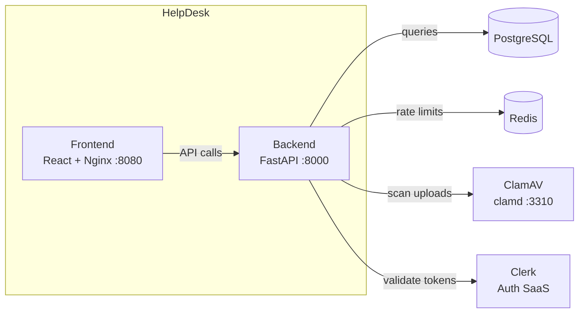

# HelpDesk

Internal support ticketing system with role-based access, attachment malware
scanning, and real-time notifications.

HelpDesk lets customers submit and track support tickets while providing staff
and administrators with tools for assignment, internal communication, and
workflow management. Uploaded attachments are scanned for malware before they
are published, and distributed rate limiting protects write endpoints from
abuse.

## Key features

- **Authentication** via Clerk — customers, staff, and administrators sign in
  with their existing identity provider.
- **Ticket management** — create, view, update, and close tickets with
  comments and file attachments.
- **Role-based access control** — Owner, Admin, Staff, and Customer roles with
  distinct permissions.
- **Attachment scanning** — mandatory ClamAV malware scan before an upload is
  published; rejected files never reach storage.
- **Distributed rate limiting** — Redis-backed limits on ticket creation,
  comments, uploads, and notification polling.
- **Notifications** — in-app notification feed for ticket updates and
  assignments.
- **Internal staff communication** — private messages between staff members
  that customers cannot see.
- **Ticket history & feedback** — full audit trail and customer satisfaction
  ratings.
- **Account upgrade requests** — customers can request staff or admin access;
  owners approve or reject.

## Technology stack

| Layer | Technology |
| --- | --- |
| **Backend** | Python 3.13, FastAPI, SQLModel (async SQLAlchemy), Alembic migrations |
| **Frontend** | React 19, TypeScript, Vite Plus, Chakra UI, Tailwind CSS |
| **Database** | PostgreSQL (psycopg v3 async driver) |
| **Authentication** | Clerk |
| **Caching / Rate limiting** | Redis |
| **Malware scanning** | ClamAV (clamd TCP) |
| **Containerisation** | Docker (backend + frontend images) |
| **CI** | GitHub Actions |
| **Deployment** | Railway (primary), Kubernetes / Helm (optional) |

## Architecture



The frontend never proxies API requests — its JavaScript bundle calls the
backend origin directly. The backend owns all business logic, database access,
and security controls.

## Prerequisites

| Service | Version | Required for |
| --- | --- | --- |
| **Python** | >= 3.13 | Backend development |
| **Node.js** | >= 24.15 | Frontend development |
| **npm** | >= 12.2 | Frontend package manager |
| **PostgreSQL** | 14+ | Local database (or use Docker) |
| **Redis** | 7+ | Rate limiting (optional for basic dev) |
| **ClamAV** | any | Malware scanning (optional for basic dev) |
| **uv** | latest | Python package manager |

PostgreSQL is required for the backend. Redis and ClamAV are required for
production; local development can run with them disabled.

## Local development quick start

```bash
# 1. Clone the repository
git clone https://github.com/mdjayedgazi/HelpDesk.git
cd HelpDesk

# 2. Backend — install dependencies
cd backend
uv sync
cp .env.example .env
# Edit .env and set DATABASE_URL, CLERK_SECRET_KEY, and FRONTEND_URL

# 3. Apply database migrations
alembic upgrade head

# 4. Start the backend (auto-reload enabled)
uv run fastapi dev app/main.py

# 5. Frontend — install dependencies (in a new terminal)
cd ../frontend
npm ci
cp .env.example .env
# Edit .env and set VITE_API_URL and VITE_CLERK_PUBLISHABLE_KEY

# 6. Start the frontend dev server
npm run dev
```

The backend starts on `http://127.0.0.1:8000` and the frontend on
`http://localhost:5173`.

## Configuration

Environment variables control application behaviour. Safe example files are
provided:

- **Backend:** `backend/.env.example` — database, Clerk, Redis, ClamAV, rate
  limiting, CORS, and logging settings.
- **Frontend:** `frontend/.env.example` — API URL, Clerk publishable key, and
  Nginx runtime settings.

Copy each `.env.example` to `.env` and fill in real values. Never commit `.env`
files — they are listed in `.gitignore`.

For production configuration details, including required variables and security
guidance, see [docs/DEPLOYMENT.md](docs/DEPLOYMENT.md).

## Testing and quality checks

### Backend

```bash
cd backend

# Run tests (SQLite + stubbed Clerk — no external services required)
uv run pytest -q

# Lint
uv run ruff check .

# Format check
uv run ruff format --check .
```

### Frontend

```bash
cd frontend

# Type check
npm run typecheck

# Lint
npm run lint

# Run tests
npm run test

# Production build
npm run build
```

## Deployment

### Railway (primary)

The project is designed for Railway deployment with two services:

- **Backend** — root directory `backend/`, uses `backend/Dockerfile`, port 8000.
- **Frontend** — root directory `frontend/`, uses `frontend/Dockerfile`, port 8080.

Full deployment instructions, including variable configuration, volume
attachment, health checks, and database setup, are in
[docs/DEPLOYMENT.md](docs/DEPLOYMENT.md).

### Kubernetes / Helm (optional)

An optional Helm chart is provided for deploying HelpDesk on Kubernetes. This
is **not** required for Railway deployment — Helm targets Kubernetes only.

The chart deploys the backend and frontend with configurable images, health
probes, resource limits, persistent storage, and optional Ingress with TLS.
PostgreSQL, Redis, and ClamAV remain external services.

See [helm/helpdesk/README.md](helm/helpdesk/README.md) for setup instructions.

## License

This project is licensed under the [MIT License](LICENSE).
